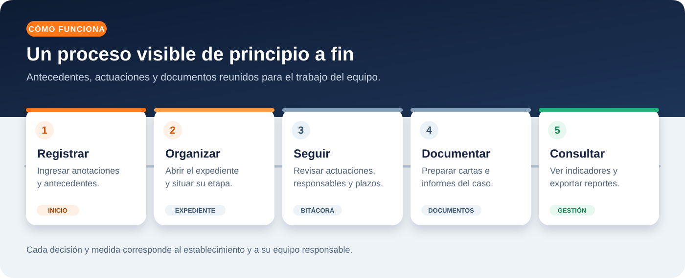
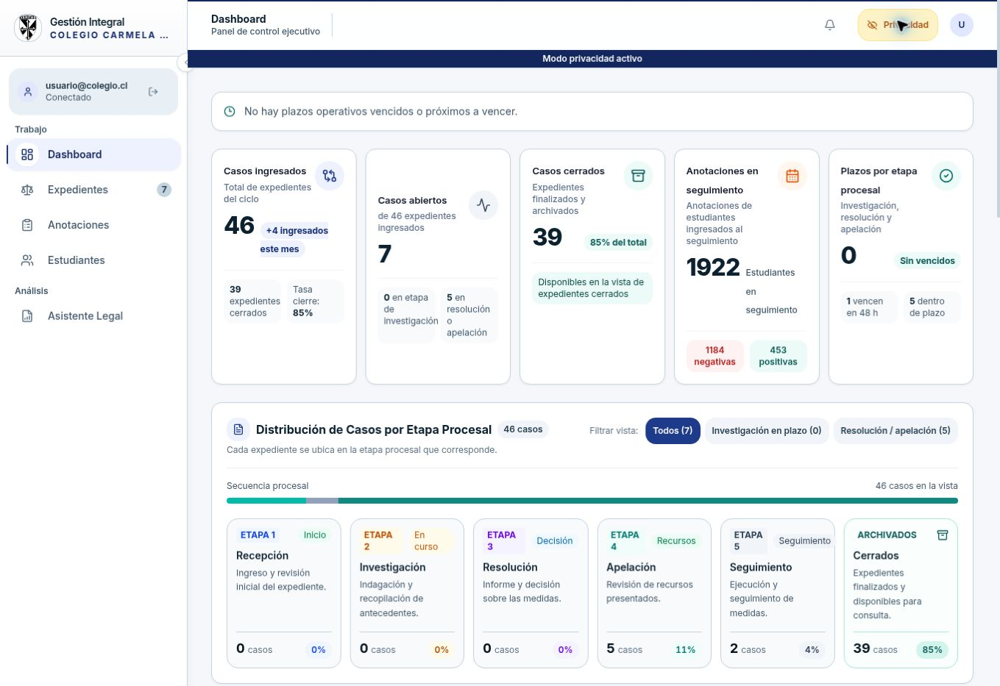
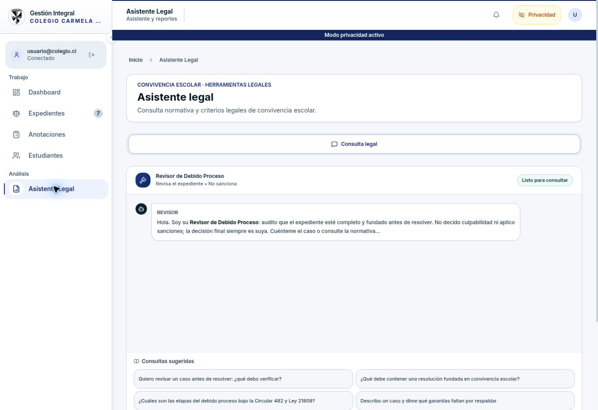
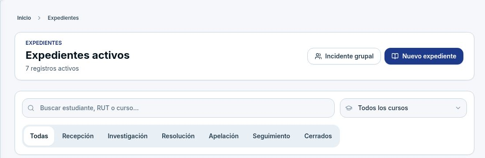
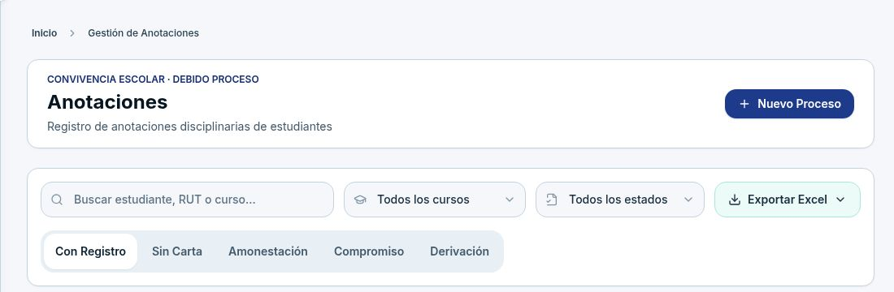
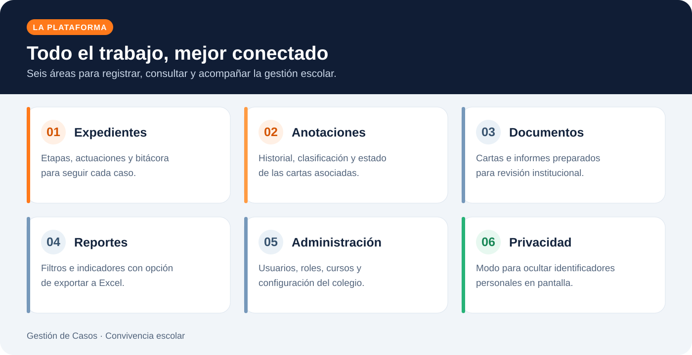
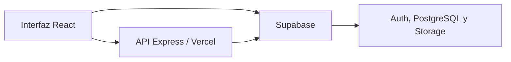

<div align="center">
  

# Gestión de Casos

### Convivencia escolar con información ordenada y seguimiento claro

Una plataforma para registrar anotaciones, gestionar expedientes, preparar documentos y consultar indicadores en un mismo lugar.

[**Conocer la plataforma**](https://gestiondecasos.vercel.app) · [Ver las pantallas](#conoce-la-plataforma) · [Explorar sus funciones](#qué-puedes-hacer) · [Consultar el proyecto](https://github.com/Hluengo/sistema-integral-convivencia-escolar/issues)

[](https://github.com/Hluengo/sistema-integral-convivencia-escolar/actions/workflows/ci.yml)


</div>

> **Para equipos directivos, convivencia escolar e inspectoría.** El acceso a la plataforma puede requerir credenciales. Su uso debe ajustarse al reglamento interno y a las decisiones del establecimiento.

## Una vista de todo el proceso

El trabajo de convivencia escolar suele distribuirse entre registros, planillas y documentos. Gestión de Casos reúne antecedentes, etapas y acciones para facilitar el seguimiento de cada situación y la coordinación del equipo.



La plataforma ayuda a documentar el trabajo; la valoración de los hechos, las medidas y la revisión de su procedencia corresponden al equipo responsable.

## Conoce la plataforma

Capturas tomadas de la aplicación en producción el 20 de noviembre de 2026, con el modo de privacidad activado. Las vistas de expedientes y anotaciones se encuadraron para no mostrar registros individuales. Las cifras del panel corresponden a la instancia mostrada y no representan resultados de otros establecimientos.

| Panel de gestión | Asistente legal |
| :---: | :---: |
|  |  |

| Expedientes | Anotaciones |
| :---: | :---: |
|  |  |

[Ver también el formulario de un nuevo expediente](docs/screenshots/nuevo-expediente.jpg).

## Qué puedes hacer



| Área | Funciones disponibles |
| --- | --- |
| **Expedientes** | Consultar etapas, responsables, bitácora y acciones del procedimiento. |
| **Anotaciones** | Revisar el historial por estudiante, la clasificación y el estado de cartas asociadas. |
| **Documentos** | Preparar documentos institucionales e imprimirlos con registro de actuaciones. |
| **Reportes** | Filtrar información, visualizar indicadores y exportar datos a Excel. |
| **Administración** | Gestionar usuarios, roles, cursos, estudiantes y configuración institucional. |
| **Privacidad** | Enmascarar nombres y RUT en pantalla mediante el modo de privacidad. |

Las secciones disponibles para cada persona dependen de su rol y permisos en el establecimiento.

### Pensado para el trabajo del establecimiento

- **Seguimiento compartido:** el equipo encuentra las actuaciones y el estado de cada expediente en un lugar común.
- **Información consultable:** filtros y reportes facilitan la revisión de anotaciones, casos y tendencias.
- **Configuración por institución:** usuarios, roles y cursos se administran según la organización del colegio.

## Seguridad y tratamiento responsable de datos

La aplicación utiliza autenticación, roles, membresías por establecimiento y políticas de acceso a datos en PostgreSQL (RLS). Las claves privilegiadas se mantienen en el servidor. El modo de privacidad reduce la exposición visual de identificadores durante el uso o una presentación.

Estas medidas técnicas requieren una configuración institucional adecuada, control de accesos y revisión de los documentos antes de comunicarlos. Más detalles en [seguridad y arquitectura](docs/architecture/security.md).

## Para equipos técnicos

**Tecnologías:** React 19, TypeScript, Vite, Tailwind CSS, Express, Supabase PostgreSQL y Supabase Auth. El repositorio incluye pruebas con `node:test`, Playwright y pgTAP.



| Carpeta | Contenido |
| --- | --- |
| `src/` | Interfaz, módulos funcionales y servicios compartidos. |
| `server/` y `api/` | API, autenticación y entrada para despliegue. |
| `supabase/` | Migraciones, políticas de acceso y validación. |
| `docs/` | [Guía de documentación](docs/README.md), arquitectura, operación y referencias. |

### Desarrollo local

Se necesita **Node.js 22**. Para conectar datos reales, configura un proyecto Supabase propio; Docker permite trabajar con Supabase local. Las funciones de IA requieren las claves correspondientes.

```bash
git clone https://github.com/Hluengo/sistema-integral-convivencia-escolar.git
cd sistema-integral-convivencia-escolar
npm ci
cp .env.example .env.local
# Configura las variables necesarias en .env.local
npm run dev
```

La aplicación de desarrollo se sirve en `http://localhost:3001`. El archivo `.env.example` enumera las variables y distingue las claves de servidor. Nunca incluyas secretos ni datos de estudiantes en un commit.

| Comando | Propósito |
| --- | --- |
| `npm run dev` | Iniciar el servidor y Vite en desarrollo. |
| `npm run typecheck` | Revisar tipos de TypeScript. |
| `npm run lint:code` | Revisar el código con ESLint. |
| `npm run test` | Ejecutar pruebas unitarias y de integración. |
| `npm run test:e2e` | Ejecutar pruebas de navegador. |
| `npm run build` | Construir la web y las entradas del servidor. |
| `npm run ci` | Ejecutar el control de calidad configurado. |

Para la configuración de despliegue, consulta [la guía de Vercel y Supabase](docs/DEPLOY.md). Para decisiones de diseño y desarrollo, consulta la [guía de documentación](docs/README.md) y el [manual de ingeniería](docs/engineering/HANDBOOK.md).

## Consultas y condiciones de uso

Para consultas sobre acceso, implementación o mejoras, utiliza [GitHub Issues](https://github.com/Hluengo/sistema-integral-convivencia-escolar/issues). El repositorio no incluye actualmente un archivo `LICENSE`: la disponibilidad del código en GitHub no concede por sí sola permiso para reutilizarlo o comercializarlo. Consulta al titular antes de hacerlo.
