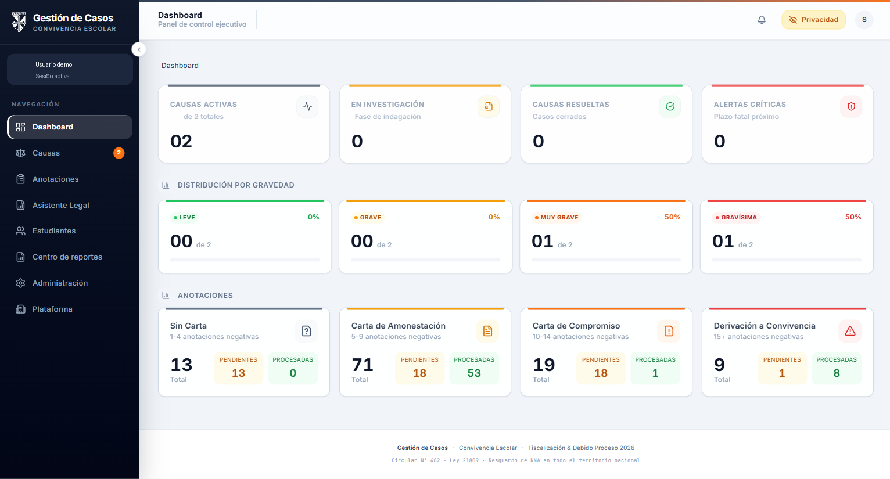
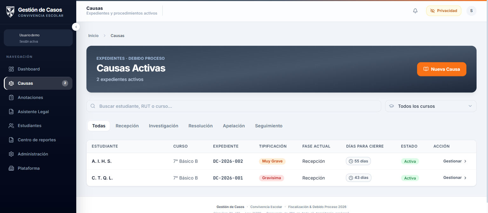
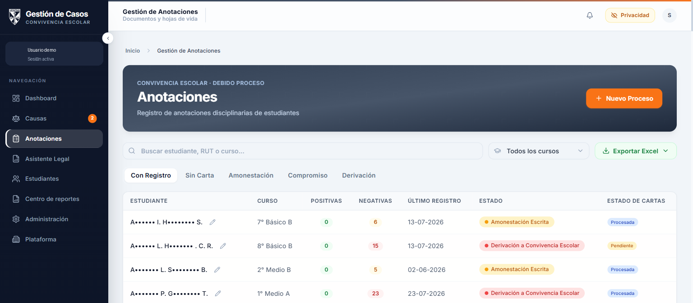
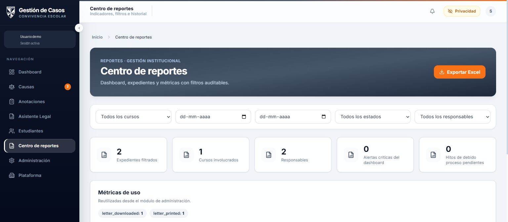
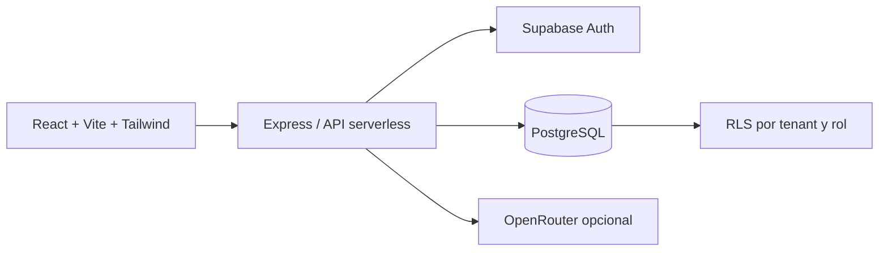

<div align="center">
  

# Sistema Integral de Convivencia Escolar

**Plataforma para gestionar expedientes, anotaciones y el debido proceso de convivencia escolar.**

  <p>
    <a href="https://gestiondecasos.vercel.app">🌐 Demo pública</a> ·
    <a href="#características">Características</a> ·
    <a href="#arquitectura">Arquitectura</a> ·
    <a href="#desarrollo-local">Desarrollo local</a>
  </p>

  <p>
    <a href="https://github.com/Hluengo/sistema-integral-convivencia-escolar/actions/workflows/ci.yml"></a>
    <a href="https://github.com/Hluengo/sistema-integral-convivencia-escolar/actions/workflows/lighthouse.yml"></a>
    
    
    
    
  </p>
</div>

> Proyecto en evolución. Está orientado a equipos de convivencia, inspectoría, dirección y administración de establecimientos educacionales chilenos. No reemplaza la revisión jurídica ni las decisiones institucionales de cada colegio.

## Qué resuelve

El sistema centraliza el trabajo que normalmente queda repartido entre planillas, documentos y registros aislados:

- **Expedientes de convivencia:** fases, estados, bitácora y checklist de debido proceso.
- **Anotaciones RICE:** clasificación de gravedad, filtros, historial y cartas asociadas.
- **Documentos:** cartas institucionales imprimibles, trazabilidad y registro de constancias físicas.
- **Reportes:** indicadores, filtros, tendencias escolares y exportación a Excel.
- **Administración:** usuarios, roles, cursos, estudiantes, reglas institucionales y configuración del colegio.
- **Privacidad:** modo de privacidad para enmascarar nombres y RUT en la interfaz.

## Capturas

Las imágenes usan datos ficticios o anonimizados y fueron tomadas con el modo privacidad activado.

|                       Dashboard                        |                      Expedientes                       |
| :----------------------------------------------------: | :----------------------------------------------------: |
|  |  |

|                   Anotaciones RICE                    |                  Centro de reportes                  |
| :---------------------------------------------------: | :--------------------------------------------------: |
|  |  |

[Ver también el asistente legal](docs/screenshots/asistente-legal.png).

## Seguridad y privacidad

El proyecto maneja información potencialmente sensible de estudiantes. Las principales barreras son:

- Aislamiento **multi-tenant** mediante `tenant_id` y políticas RLS de PostgreSQL.
- Autenticación Supabase y verificación JWT en rutas protegidas.
- Roles y membresías por establecimiento.
- `SUPABASE_SERVICE_ROLE_KEY` solo en servidor.
- Validación y sanitización de entradas antes de persistir o invocar servicios externos.
- Modo privacidad para reducir la exposición visual de nombres y RUT.
- Pruebas de aislamiento por tenant con pgTAP.

Consulta la [documentación de seguridad](docs/architecture/security.md) y la [constitución del proyecto](docs/CONSTITUTION.md). La seguridad técnica no reemplaza controles institucionales, base legal, gestión de accesos ni revisión jurídica.

## Arquitectura



- `src/app/`: shell, navegación y providers.
- `src/features/`: causas, anotaciones, documentos y reportes.
- `src/shared/`: servicios, stores Zustand, hooks, schemas Zod y UI compartida.
- `server/`: Express, middleware de autenticación, membresías y rutas API.
- `supabase/migrations/`: esquema, RPCs, índices y políticas RLS.

Para una vista más detallada, revisa [`docs/architecture/project-overview.md`](docs/architecture/project-overview.md).

## Stack

| Capa           | Tecnología                                                |
| -------------- | --------------------------------------------------------- |
| Frontend       | React 19, TypeScript, Vite 8, Tailwind CSS 4              |
| UI y estado    | Radix UI, Zustand, TanStack Query, React Hook Form, Zod   |
| Backend        | Node.js, Express, esbuild                                 |
| Datos y auth   | Supabase PostgreSQL, Supabase Auth, RLS                   |
| Documentos     | `pdfjs-dist`, `react-to-print`, exportación Excel         |
| Observabilidad | Sentry, PostHog, Web Vitals                               |
| Calidad        | `node:test`, Testing Library, Playwright, axe-core, pgTAP |

## Desarrollo local

### Requisitos

- Node.js 22
- Docker Desktop para Supabase local
- Cuenta Supabase solo si se conecta a un proyecto propio
- OpenRouter opcional para funciones de asistencia editorial

### Instalación

```bash
git clone https://github.com/Hluengo/sistema-integral-convivencia-escolar.git
cd sistema-integral-convivencia-escolar
npm install
cp .env.example .env.local
npm run dev
```

La aplicación queda en `http://localhost:3001`. No copies secretos desde otro entorno. Usa `.env.example` como plantilla y conserva las claves privilegiadas únicamente en el servidor.

### Comandos principales

```bash
npm run dev              # desarrollo con Express + Vite HMR
npm run lint             # ESLint + TypeScript
npm run test             # tests unitarios e integración
npm run test:coverage    # tests con cobertura mínima de líneas
npm run test:e2e         # Playwright
npm run build            # build web + servidor + API generado
npm run build:storybook  # catálogo visual de componentes
npm run ci               # lint + cobertura + build + auditoría
```

## Estado de calidad

Verificación local más reciente:

- **1018/1018 tests** aprobados en 217 suites.
- Cobertura: **91,34 % líneas**, **82,86 % ramas**, **91,67 % funciones**.
- Build de producción aprobado.
- Build de Storybook aprobado.
- `npm audit --omit=dev`: 0 vulnerabilidades.
- Bundle dentro del presupuesto configurado.

## Roadmap

- Mejorar cobertura de comportamiento de componentes React.
- Ampliar pruebas E2E autenticadas por rol y establecimiento.
- Completar reportes avanzados y flujos administrativos.
- Evaluar modo offline y nuevos módulos institucionales.

El detalle vivo está en [`docs/architecture/future-roadmap.md`](docs/architecture/future-roadmap.md).

## Contribuir

1. Lee [`docs/CONSTITUTION.md`](docs/CONSTITUTION.md) y [`docs/engineering/HANDBOOK.md`](docs/engineering/HANDBOOK.md).
2. Crea una rama desde `master`.
3. Mantén los datos de estudiantes ficticios o anonimizados en tests, capturas y documentación.
4. Ejecuta `npm run ci` antes de abrir un pull request.
5. Describe claramente los cambios de seguridad, datos o permisos.

## Licencia

Este repositorio todavía no declara una licencia pública en un archivo `LICENSE`. Antes de reutilizar, distribuir o incorporar el código en otro producto, confirma la licencia con el autor.

## Contacto

Para sugerencias o reportes, usa [GitHub Issues](https://github.com/Hluengo/sistema-integral-convivencia-escolar/issues).
